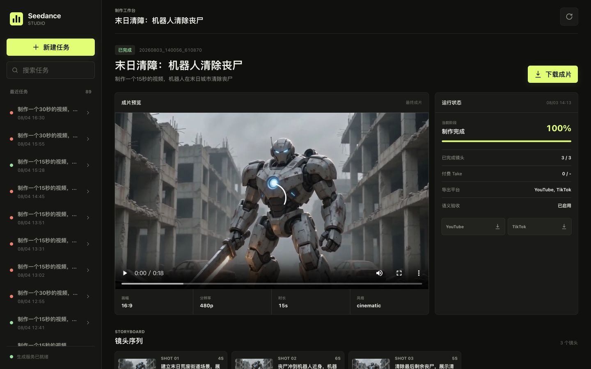

# Seedance


一个可恢复、可验证的 AI 短视频生产流水线。输入一句中文需求，即可完成生产计划、分镜、视频片段、转场、调色、配乐、口播、字幕和多平台导出。

项目通过火山引擎 Ark 调用 Seedance 2.0 Mini，并同时提供 Web 工作台和 CLI。它不会把长提示词直接交给视频模型，而是先编译为可验证的生产计划，再按镜头顺序生成和验收。

> [!IMPORTANT]
> 本项目是非官方实现。模型可用性、接口参数和价格以[火山方舟官方文档](https://www.volcengine.com/docs/82379)为准。真实生成会调用付费服务。

## 成片示例

https://github.com/user-attachments/assets/abfd9e19-f63f-427c-8dd5-d67ad66afc87

该样例由本项目完成生产计划、分镜、片段生成、验收、后期与导出；成片 33.5 秒，输出规格为 480p、16:9。[下载原始 MP4](https://github.com/briefness/InstantVideo/releases/download/demo-20260803/final.mp4)。

## Web 工作台



工作台可创建任务、查看已有工作区、跟踪镜头进度、恢复中断任务，以及预览和下载成片。它直接复用 CLI 的 `VideoPipeline`、运行账本和恢复规则，不维护第二套生成逻辑。

```bash
python web_server.py
```

打开 <http://127.0.0.1:8765>。服务默认只监听本机地址；关闭浏览器不会中断服务端正在执行的任务。

## 先看完整预览片

新任务可选择 `--delivery-mode preview`（网页中的“先完成预览片”）。系统沿用已配置的模型、正式规划、镜头顺序和实际尾帧衔接，生成各段后自动拼接、处理音画并导出 `preview.mp4`。此模式只检查技术可用性，不逐镜调用视觉验收，也不把计划中的动作结果冒充实际观察；人物、动作和运镜均为待验收。

```bash
# 仅规划，不提交视频；交付方式随工作区保存
python main.py "约15秒，三段连续的双人舞" --plan-only \
  --delivery-mode preview --take-policy single_pass --paid-take-budget 0
```

预览片不等于合格成片。`delivery_report.json` 分别记录技术检查和内容验收状态。预算不足、远端状态不明、损坏视频或必要素材缺失仍会停止；不会用重复片段补齐。付费授权仍须另行明确，`single_pass` 每镜最多一次提交；本地导出失败后恢复复用已有片段。`--resume` 沿用原交付方式，不允许把旧失败任务自动改成预览模式。未指定时仍采用原有 `reviewed` 逐镜验收流程。

## 核心能力

- **结果只判定一次**：新创作按人物和物体记录可观察结果，无需作者同时决定验收重要性。所有结果候选完整交给独立审查；可替换细节仍用于生成，必要结果才成为执行义务。待审稿不能提交付费视频，旧任务保持原有含义。
- **结构化生产计划**：先解释完整需求的重心、节奏和明确结局，保存原文依据，再冻结时长与镜头职责。解析失败会停止，不按关键词降级猜测。
- **动作时间预算**：密集动作按节拍的实际交互时段校验，不把整镜时长算作打斗时间；入场、停顿、运镜和结果保持分开计时。
- **统一动作合约**：用 Action Contract 表达接触、定向路径、区域与间接作用；多事件各自保留执行者、目标、作用与反应时刻、可见结果，允许角色交替，不再把连续动作压成一次接触。
- **连续性传递**：同场景镜头使用上一条已接受镜头的真实尾帧作为 `first_frame`，跨场景才切换独立身份参考。
- **按实际状态续拍**：在提交前检查真实尾帧与已验收终态。旧模式仅调整入场过渡；v6 表现编舞还可调整首个交互的进入路径，但参与者、作用结果、后续节拍、结局和运镜保持不变。方案与尾帧哈希落盘，恢复复用同一方案，不兼容时暂停。
- **区分编舞建议与硬要求**：v6 将精确复现与表现编舞分开；后者允许路径和节奏变化，仍需证明每次作用、反应和状态变化，并以实际时间证据计算交互密度。原始需求单独验收，旧任务不自动放宽。
- **明确身份参考绑定**：可在首次视频执行前准备本地定妆素材。系统验证图片、角色 ID 和内容哈希，并按实际请求顺序绑定图片编号。缺少素材会记录为文字起拍；已绑定素材失效不能静默丢弃或换绑。[准备格式与边界](docs/director-execution.md#2026-10-29制作意图执行与验收分层)
- **可执行运镜**：结构化主运镜、速度、起止景别和轴线进入普通请求、安全重试、验收与指纹；无法识别的主运镜在提交前报错。
- **双层质量检查**：执行技术质量检查和可选的时序语义验收，失败只允许有限、定向的处理。
- **付费提交前硬门**：在调用 Provider 前校验模型、分辨率、画幅、时长、生成链、Action Contract 投影与视觉锁，配置或编译结果不完整时直接停止。
- **安全恢复**：持久化任务 ID、提示词指纹、合约签名、参考职责和验收上下文，避免恢复时重复提交付费任务。
- **可审计失败证据**：把 Provider、技术 QA、语义验收和状态错误记录为结构化证据，并从 `run_manifest.json` 只读派生 Take、尝试与失败模式统计。
- **完整后期链路**：自动完成规格统一、转场、BGM、TTS、LUT、字幕与多平台导出。按分镜时长剪辑，不额外添加片头；动作片硬切以保留招式时间。
- **双入口**：Web 工作台和 CLI 共享同一套流水线与工作区格式。

## 工作原理

```text
用户需求
  -> 完整语义意图与原文依据
  -> 生产计划与故事骨架
  -> 分镜详情与生成前就绪校验
  -> 严格顺序视频生成
  -> 技术 QA + 可选语义验收
  -> 已接受终态交接到下一镜
  -> 规格统一 / 转场 / 音频 / 调色 / 字幕 / 导出
```

对动作镜头，系统把准备、作用、结果与范围外主体拆到结构化合同中。Provider 提示词、安全重编译、语义验收和定向重拍共享同一合同投影，避免为单个题材添加关键词补丁。

恢复时，已接受的本地片段只会在验收上下文匹配时复用；上下文变化会先触发离线复核。远端未决任务只轮询原任务，不重新提交。已返回但本地下载或技术 QA 失败的任务会停止，避免隐式重复扣费。

失败统计不解析可能变化的自然语言错误信息，也不维护第二套账本。只有已接受 Take 可以推进 Canonical State；失败模式按同一提示词指纹聚合，样本不足时明确返回 `insufficient_evidence`，不会把单次失败推断成结构性问题。

15 秒密集动作请求分为三个 5 秒片段，每镜至少 3.5 秒主体交互，末镜至少留 0.5 秒确认已建立的结果。新 v5 计划在明确要求结局时，将最低事件配额分配为 2/3/1，避免把受击倒下计作另一招；没有明确结局时仍为 2/2/2。程序固定镜头槽位、编译动作时间，模型只写动作原因与结果。创作接口使用严格 JSON Schema，失败不整稿重试或降级普通 JSON。普通请求、安全重试和验收使用同一时间契约；中间事件缺失不能由最终结果替代。70%、事件配额和 0.5 秒是当前工程默认值，不是已验证的最佳节奏。

上述能力属于正式 `VideoPipeline`，不是样片专用脚本。新多事件运行依次解析意图、冻结故事身份、逐镜创作，并在付费前独立审查动作语义；检查覆盖每个节拍，证据由程序从原字段取回，拒绝时停止而不改稿。审稿报告绑定稿件、模型和版本，恢复复用并校验，不一致时停止。结构通过不等于语义正确，模型审稿也可能误判。离线测试证明协议、请求传递、恢复和媒体拼接，不证明真实模型的理解准确率或电影级观感。实现依据、验收边界和 GitHub 参考见 [导演执行闭环](docs/director-execution.md)。

可使用 `python main.py "15秒动作短片需求" --plan-only --paid-take-budget 3` 先生成并审查完整分镜。该模式只调用文本模型，不预约或提交视频任务；计划保存在输出工作区。确认后用 `python main.py --resume <工作区路径>` 执行同一计划，不重写分镜。新多事件创作对支持的 Seed 模型显式开启思考；提取和既有短输出调用保留原设置。思考参数不能保证创意或动作一定正确，仍需通过独立检查与真实画面验收。

需求解释的依据由原文语句限定，模型只能选择，不再自由拼接引文；动作响应与作用方式使用同一组合法组合约束生成和校验。相对时间权重作用于完整镜头，只有最低交互时间、单动作下限和结果停留要求不满足时才调整。失败的意图返回与安全错误分类保存在工作区，便于重放，不记录接口异常中的请求头。临时用 `LLM_MODEL` 选择文本模型时，恢复该计划也应使用相同模型，避免审核指纹失配。

新事件计划在存在多个场景编号时，还会独立核对实际地点归属，避免模型逐镜编号导致同地点丢失尾帧参考。`scene_binding_review.json` 保存绑定依据和稿件指纹，`execution_storyboard.json` 保存执行用的场景归属；原分镜和动作文字不改写。真正换地点仍保持独立，归属不确定或新绑定会改变已提交镜头时停止。恢复只复用与原稿一致的绑定；这一步判断地点语义，不代表视频已经保持人物或动作一致。

## 动作预演（离线实验）

已有编导动作稿时，可通过 `python -m tools.prepare_authored_run <动作稿.json>` 离线导入新工作区，再用 `main.py --resume <工作区> --plan-only` 做相同的独立语义检查。导入默认视频预算为零，保留署名和输入指纹，不覆盖自动创作失败记录；后续生成、验收、连续性与拼接仍走正式流程。输入格式与辅助创作示例见 [紫禁·借势归锋](examples/zijin_directed/README.md)。辅助编导的成功不代表自动分镜已稳定。

正式流程也可准备动作参考：在需求中明确要求骨架/建模动作参考，或使用 `--motion-control reference_motion`。同一工作区自动进行数值规划、几何校验和 FFmpeg 导出；模型规划最多纠正一次，恢复时复核文件且不重复规划。数值规划调用文本模型，视频预算为零不代表文本模型免费。Web API 接受相同 `motion_control` 参数；默认 `auto` 遵循冻结需求，`text_guided` 不得覆盖已明确的参考要求。

`execution_control.json` 记录实际的文字或参考视频模式，`motion_preparation.json` 记录来源和准备结果。没有托管地址时停在 `prepared_unbound`，保留真实 `reference.mp4`；超出下述 v1 范围时返回 `unsupported`。两者都不会隐式退回文字生成或消耗视频 Take。现有上传/素材绑定工具用于后续接入；不会自动购买存储或上传素材。多事件文本规划已经支持，但复杂连招、武器、移动相机和跨镜头动作预演尚未实现，不能将文本事件合同等同于轨迹控制。

可在生成前先用二维骨架编排一个双人接触动作，检查关键帧、接触位置和反应顺序。当前版本支持**独立镜头、固定机位、两个双足角色、一次直接接触**；不会自动把复杂打斗简化成模板，也不会把预演当成已生成或已验收的视频。

```bash
# 检查示例：不需要 API Key，不调用生成服务
python -m tools.motion_previs validate \
  --storyboard examples/contact_previs/storyboard.json \
  --plan examples/contact_previs/motion.json

# 导出 4 秒预演视频、关键帧拼图、逐帧坐标和实验方案
# output 父目录须已存在；已有目标目录不会被覆盖
python -m tools.motion_previs render \
  --storyboard examples/contact_previs/storyboard.json \
  --plan examples/contact_previs/motion.json \
  --output output/contact-previs
```

导出需要已安装的 Pillow、Pydantic、FFmpeg 和 ffprobe，无需 Blender、GPU 或额外模型。打开输出目录中的 `preview.mp4` 查看动作，`contact_sheet.png` 对照准备、接触、反应和收势。检查失败时退出码为 `2`，并给出原因。

自验同时检查真实编码画面：在采样时刻独立核对角色颜色、数值关节位置及前景像素，防止规格和哈希正确但内容黑屏、静止、倒放或位置错误。该检查用于受控骨架参考，不代替生成视频的语义验收。新工作区在参考视频旁保存 `motion_plan.json`；旧工作区缺失计划会明确停止，需从原预演包离线重新准备，不会自动重建或扣费。

另行导出无标注的 `reference.mp4`，供动作输入使用。生成接口支持绑定 `asset://` 视频素材或公网 HTTPS 文件直链，当前限定单镜头独立工作区，不能与首尾帧模式混用。文件、源分镜、模型与素材地址纳入提交和验收记录；变化后停止复用或恢复。

```bash
# 只准备本地工作区，默认预算 0，不上传、不生成
python -m tools.prepare_motion_run \
  --storyboard examples/contact_previs/storyboard.json \
  --package output/contact-previs --output-root output
```

也可给准备命令添加 `--video-url https://你的文件域名/不可覆盖的文件名.mp4`（实际地址须为 ASCII URL），无需先入库取得素材 ID。该步骤仍不访问链接；实际创建生成任务前才下载核对远端 SHA-256，失败则停止并释放预留预算。链接须无登录、无查询参数、无跳转且可公开读取；不接受私网地址。URL 方式不能与 `--asset-uri` 同时使用。

几何检查通过不代表 Seedance 会遵循预演。尚未执行付费对照实验；真实生成前还需要托管同一文件、配置可用模型，并明确授权预算。预演和离线准备不会推进 Canonical State。

自定义建模、输入格式、开源参考和验证边界见 [动作预演说明](examples/contact_previs/README.md)。

上传与对照实验现在也有独立入口，默认只做离线检查：

```bash
python -m tools.publish_motion_reference --package output/contact-previs
python -m tools.motion_experiment prepare \
  --storyboard examples/contact_previs/storyboard.json \
  --package output/contact-previs --output output/contact-experiment
python -m tools.motion_experiment check --experiment output/contact-experiment
python -m tools.motion_experiment report --experiment output/contact-experiment
```

默认准备三对、共六个零预算样本；检查返回阻塞是预期保护。后续明确执行时，上传工具使用条件 PUT 和 SHA-256 对象名，实验工具每个样本最多允许一个付费 Take，恢复只轮询原任务。支持原始 Take 导出、隐藏分组标签、人工帧号记录和汇总；不自动把技术通过记为动作正确。真实运行步骤见示例说明的“完整实验操作”。

评审支持明确的“未评／无法判断／已评”状态和双人分歧核对。可先运行 `python -m tools.motion_calibration build --output output/contact-review-calibration` 生成六个离线教学案例，再用 `score --bundle output/contact-review-calibration` 核对人工填写的评分表。空白表单保持未评估；校准包不属于真实生成结果，详细说明见“离线反例校准与双人复核”。

## 环境要求

- Python 3.11 或 3.12。Python 3.14 目前会触发 Ark SDK 的 Pydantic V1 兼容警告。
- [FFmpeg](https://ffmpeg.org/download.html) 与 `ffprobe`。
- 已开通 Seedance 2.0 Mini 的火山方舟 API Key。
- macOS 默认使用系统 `say` 生成口播；其他系统可配置豆包语音合成。

安装 FFmpeg：

```bash
# macOS
brew install ffmpeg

# Ubuntu / Debian
sudo apt install ffmpeg
```

确认本地环境：

```bash
python --version
ffmpeg -version
python main.py --help
```

建议在独立虚拟环境中安装依赖，并运行 `python -m pip check`。不要在依赖不一致的共享环境中执行真实 API 验收；模块可以导入不代表运行环境完整可用。

## 快速开始

### 1. 安装依赖

```bash
python -m pip install -r requirements.txt
```

### 2. 配置环境变量

```bash
cp .env.example .env
```

编辑 `.env`，至少填写：

```dotenv
ARK_API_KEY=your_ark_api_key
```

### 3. 启动 Web 工作台

```bash
python web_server.py
```

或者直接使用 CLI：

```bash
python main.py "制作一个15秒的视频，机器人在末日城市清除丧尸"
```

首次生成会创建独立的 `output/<run_id>/` 工作区。不要提交 `.env`、`output/` 或其中可能包含的私有媒体。

## CLI 用法

```bash
# 基础生成
python main.py "15秒咖啡品牌广告，从咖啡豆到拿铁的过程"

# 720p 与指定风格
python main.py "科技感产品介绍" --resolution 720p --style futuristic

# 竖版与指定导出平台
python main.py "旅行短视频" --ratio 9:16 --platforms tiktok instagram_reels

# 指定背景音乐
python main.py "运动品牌宣传" --music music/upbeat_electronic.mp3

# 限制本次运行允许提交的付费 Take 数量
python main.py "30秒末日动作短片" --paid-take-budget 8

# 从已有工作区恢复
python main.py --resume output/20260730_153000_123456
```

支持的输出规格：

| 类型 | 可选值 | 默认值 |
| --- | --- | --- |
| 分辨率 | `480p`、`720p` | `480p` |
| 画幅 | `16:9`、`9:16`、`4:3`、`1:1`、`3:4`、`21:9` | `16:9` |
| 平台 | `youtube`、`tiktok`、`bilibili`、`instagram_reels`、`instagram_feed` | `youtube`、`tiktok` |

请求 `720p` 时，生成链允许同模型降级到 `480p`。完整参数以 `python main.py --help` 为准。

## 配置

默认值由 [`.env.example`](.env.example) 和 [`config.py`](config.py) 共同定义。

| 变量 | 必填 | 说明 |
| --- | --- | --- |
| `ARK_API_KEY` | 是 | Ark 默认 API Key，供 LLM 与视频接口使用。 |
| `ARK_API_KEY_SEEDANCE` | 否 | 可选独立视频 Key；Agent Plan 直接复用 `ARK_API_KEY`。 |
| `ARK_BASE_URL` | 否 | 分镜 LLM 接口。 |
| `ARK_BASE_URL_SEEDANCE` | 否 | 共享 Key 默认跟随 `ARK_BASE_URL`；独立视频 Key 默认 `/api/v3`。显式 URL 优先。Agent Plan 应使用 `/api/plan/v3`。 |
| `SEEDANCE_MODEL` | 否 | 代码默认 `doubao-seedance-2-0-mini-260615`；Agent Plan 使用 `doubao-seedance-2.0-mini` / `doubao-seedance-2.0-fast` 等官方名称，不能混用接口与模型名。 |
| `LLM_MODEL` | 否 | 分镜文本模型，默认 `doubao-seed-2.0-lite`。 |
| `SEMANTIC_REVIEW_MODEL` | 否 | 语义验收模型，默认复用 `LLM_MODEL`。 |
| `SEMANTIC_REVIEW_ENABLED` | 否 | 是否启用语义验收，默认 `true`。关闭后仅记录技术验收。 |
| `SEMANTIC_REVIEW_IMAGE_DETAIL` | 否 | 语义验收图片细节级别，默认 `high`。 |
| `TTS_ENGINE` | 否 | `macos` 或 `volcano`，默认 `macos`。 |
| `TTS_VOICE` | 否 | macOS 口播音色，默认 `Tingting`。 |
| `VOLCANO_TTS_API_KEY` | 否 | 使用 `TTS_ENGINE=volcano` 时需要。 |

## 恢复与费用安全

真实生成会调用付费的 LLM、视频生成、可选语义验收和可选 TTS 服务。

- `--resume` 使用原运行参数，不能同时覆盖画幅、风格、音乐、平台或付费 Take 预算。
- 已提交但未决的远端任务会记录不可变提交描述符；恢复时仅轮询同一任务 ID。
- 下载暂时失败后会继续获取同一结果，不创建第二个任务。
- 已接受镜头会复用；验收上下文变化时先离线复核，不降低质量门强行放行。
- 语义失败最多触发一次定向重拍；被拒片段不会成为后续镜头的状态或身份参考。
- `--paid-take-budget N` 在提交前预留授权并写入 `run_manifest.json`；轮询已有任务不消耗新预算。
- 只有已验收且成功提取的身份锚点才能重置 `Reference Chain Depth`。
- 本地物化或技术 QA 失败会显式停止，不授权恢复流程自动提交新的付费任务。

自动化测试不应使用真实 Key 或真实视频生成任务。

## 输出目录

```text
output/<run_id>/
├── storyboard.json          # 已确认的分镜
├── run_manifest.json        # 参数、镜头状态、恢复与验收元数据
├── generation_results.json  # 片段生成结果
├── shots/                   # 原始镜头、尾帧与生成谱系
├── normalized/              # 统一规格后的片段
├── semantic_reviews/        # 本地语义验收缓存
├── exports/                 # 平台导出文件
└── final.mp4                # 最终成片
```

工作区是恢复的唯一依据。移动或清理其中的 `run_manifest.json`、镜头、尾帧或谱系文件，会使恢复流程无法安全判断状态并主动停止。

## 项目结构

```text
seedance/
├── main.py                 # CLI 入口
├── web_server.py           # Web 工作台服务入口
├── web/                    # 原生 HTML、CSS 与 JavaScript 界面
├── config.py               # 支持规格、模型与运行默认值
├── pipeline/               # 分镜、合约、生成、验收、恢复与编排
├── tools/                  # Ark、FFmpeg、TTS、节拍与帧处理
├── prompts/                # 分镜系统提示词
├── luts/                   # LUT 调色文件
├── music/                  # 本地背景音乐库
├── assets/screenshots/     # README 截图
├── tests/                  # 离线测试
├── docs/adr/               # 架构决策记录
└── output/                 # 每次运行的独立工作区
```

主要代码入口：`main.py`、`web_server.py`、`pipeline/orchestrator.py`、`pipeline/storyboard.py`、`pipeline/generator.py`、`pipeline/run_state.py`。

## 测试

测试使用本地 fixture、模拟 Provider 和临时工作区，不会调用真实 Ark/Seedance API，也不会产生视频生成费用。

```bash
# 完整回归测试
python -m pytest -q

# Python 编译检查
python -m compileall -q pipeline tests

# Web 前端语法检查
node --check web/app.js
```

测试覆盖分镜合约、时长与规格约束、Provider 能力契约、付费提交前校验、动作因果、视觉不变量、结构化失败证据、生产统计、状态恢复、转场、音频时间线和 Web 适配层。离线行为评测矩阵覆盖 15/30 秒、action/product/balanced、单/多角色、同/跨场景、四种交互模式以及 normal/policy-safe 编译。

离线测试不会替代真实链路验收。发布前仍需在受支持的 Python 3.11/3.12 独立环境中验证真实视频生成、远程语义验收和所选远程 TTS。

## 架构约束

生产计划、Provider 提示词、语义验收和定向重拍必须共享同一 Action Contract，不得各自解释动作语义。Planned State、Observed State 与 Canonical State 相互分离，只有已接受 Take 可以推进 Canonical State。完整决策见 [`docs/adr/0001-single-action-contract-owner.md`](docs/adr/0001-single-action-contract-owner.md)。

## 已知限制

- Seedance 2.0 Mini 当前仅支持 `480p` 与 `720p`，不支持 `1080p`。
- 生成式视频仍可能出现主体漂移、复杂交互失真、文字渲染错误或物理因果不稳定。
- 语义验收会提高可靠性，但同时增加模型调用、运行时间与费用。
- 按观察状态调整起手动作也会调用配置的文本模型；没有观察证据时不虚构调整。它只处理同场景、使用真实尾帧、具有多段动作节拍的 active 镜头，不自动重写整个故事或修复已生成的错误动作。
- 新运镜验收版本不会把旧片段自动当作已满足新要求。已有远端任务若缺少所需续拍来源记录，会停止并保留原任务，不隐式重新生成；旧成片文件不受改写。
- 同场景连续性依赖上一镜已接受尾帧；尾帧不可用或被接口拒绝时，流水线会停止依赖镜头。
- Linux 和 Windows 默认没有 macOS `say`，需要配置豆包语音或接受无口播输出。
- 背景音乐和 LUT 依赖本地文件；文件缺失时会跳过对应处理或使用可用替代路径。
- 非动作片的转场重叠会缩短成片时长；动作片按分镜时长硬切，并以 0.15 秒容差检查最终封装时长。原片短于计划时长会停止，不用定格补足。技术时长通过不代表人物、招式或运镜已通过观感验收。

## 贡献

提交 Issue 时请附上复现命令、完整错误信息，以及可脱敏的 `output/<run_id>/run_manifest.json`。不要提交 `.env`、API Key、私有素材或完整付费生成产物。

提交 Pull Request 前请运行测试和编译检查。生成、恢复或验收相关改动必须使用模拟 Provider 覆盖，不得把真实付费生成作为自动化测试步骤。

## License

本项目基于 [MIT License](LICENSE) 发布。
